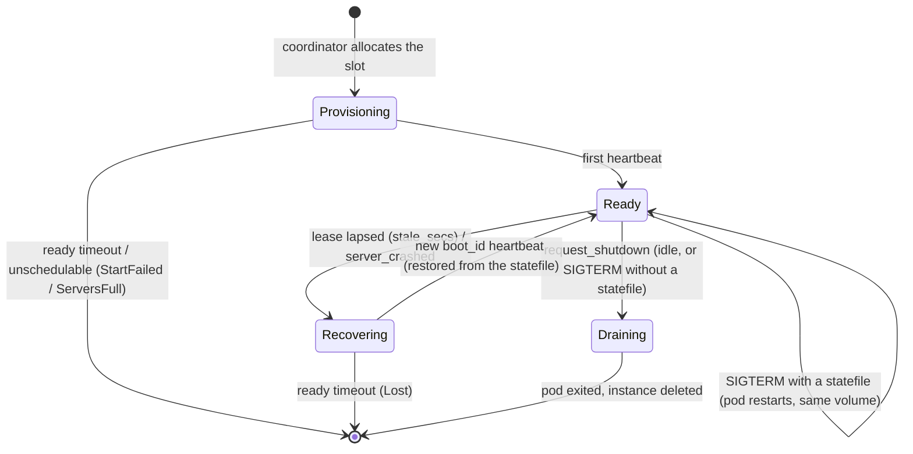
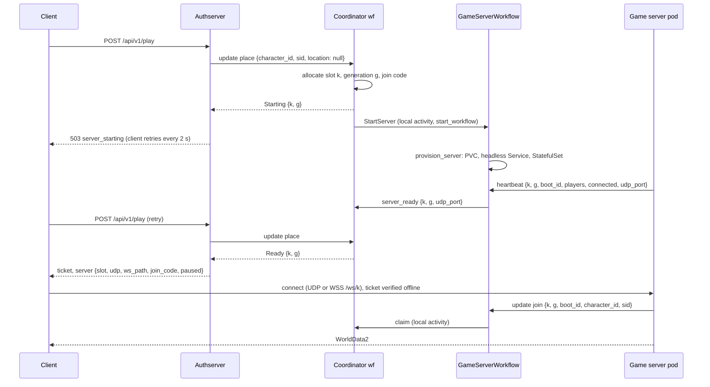
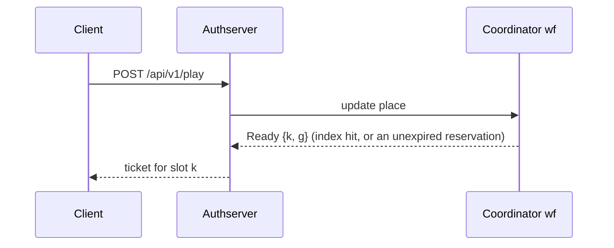
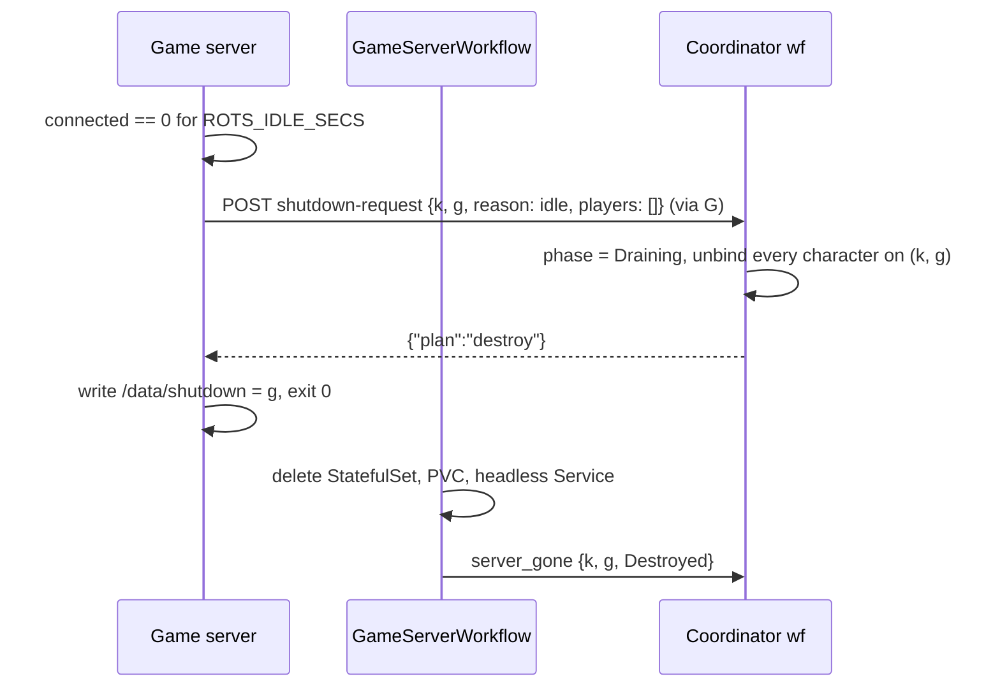

# Game-server scaling

How ROTS creates, owns and retires game-server instances. Slice A is implemented: a fresh tutorial
instance per new player, a Temporal workflow per instance, idle self-destruction and
`servers_full`. Slice B is implemented too: the statefile, ghosts (characters that outlive a
disconnect), the restoring pause, probe/kill/recover and the client's reconnect path. Slices C
(join codes, successor migration) and D (pause, chat) are marked **pending** below.

## Summary

Each game-server instance is a **one-replica StatefulSet with its own PVC**, created at runtime by
the authserver, and each instance is owned by its own Temporal workflow
`rots-gs-<queue>-<k>-g<g>`. An instance decides when it is finished: when nobody has been
connected for `ROTS_IDLE_SECS` it asks the coordinator what to do with its players, and the
coordinator answers `destroy` — the server writes a shutdown sentinel, exits, and the workflow
deletes the StatefulSet and PVC.

- The **coordinator** (`rots-coordinator-<queue>`, one per environment) owns the directory of
  slots, the character index, reservations, placement and spawn decisions. It receives **no
  heartbeats**; heartbeats go to the instance's own workflow.
- Placement is per character, by the chosen character's position. No character has a saved
  position yet, so today every `/play` for an unbound character allocates a new instance.
- Capacity is the cluster's: a ResourceQuota. When it is exhausted the player is told
  `servers_full` and the client retries every 5 s.
- prod still runs the **static** fleet (`rots-gameserver-0..3`, `GAME_SERVER_PROVISIONER=static`)
  until the prod switch (#122). The managed path is what previews and, later, prod use.

## Ownership and identity

| Thing | What it is |
|---|---|
| Slot `k` | The network lease: the `/ws/k` route, Services `rots-gs-k` and `rots-gs-k-udp`, public UDP port `udpPortBase + k`, ticket `srv = k`, env `ROTS_SERVER_SLOT = k`. prod uses slots 0–399. |
| Generation `g` | A `u64` the coordinator allocates, unique across slots, carried across continue-as-new. It names one instance incarnation: a successor or a recovery keeps the slot but never reuses a generation. |
| `boot_id` | The process incarnation, as before: a restart is visible to the coordinator even inside one generation. |
| Instance name | `rots-gs-<k>-g<g>`: the StatefulSet, its headless Service and the label `rots.2143.me/instance`. The PVC is `data-rots-gs-<k>-g<g>-0`. |
| Workflow id | `rots-gs-<queue>-<k>-g<g>` (`server_id(queue, slot, generation)`). |
| Join code | 4 characters from `ABCDEFGHJKLMNPQRSTUVWXYZ23456789`, unique among live instances, derived from a seed the coordinator carries so it is replay-safe. Only tutorial instances get one. |
| Statefile | `$ROTS_STATE_DIR/state.bin` on the instance's volume: postcard `WorldSnapshot { version, tick, terrain, paused, units, players }`, written every 5 s and once on SIGTERM (write `state.bin.tmp`, fsync, rename). |
| Static mode | `GAME_SERVER_PROVISIONER=static` (prod today, local dev): servers are external, report `generation` 1 and are placed by "least loaded"; nothing provisions or deletes them. |

The report env a provisioner sets on a managed instance is
`ROTS_SERVER_SLOT`, `ROTS_SERVER_GENERATION`, `ROTS_SERVER_JOIN_CODE`, `ROTS_PUBLIC_UDP_PORT`,
`ROTS_STATE_DIR` and `ROTS_IDLE_SECS`. The game server treats `ROTS_SERVER_GENERATION` as the flag
that it is managed: with it unset it behaves exactly as a static server does.

## Workflows



**Coordinator** (`rots-authserver/src/temporal/coordinator.rs`): owns `servers: slot →
{generation, phase, join_code, udp_port, paused, connected}`, `index: character → {slot,
generation, sid}`, reservations, `next_generation`, `code_seed`, the start-failure counter and the
`full_until` / `spawn_paused_until` gates. Its interface:

- update `place { character_id, sid, location }` → `Ready | Starting | Recovering | NoGameServer | ServersFull`;
- update `claim { slot, generation, character_id, sid }` → `Admitted | AlreadyOnOtherServer |
  ServerDraining | UnknownInstance`;
- signal `release { slot, generation, character_id }` (the character's units left the world);
- signal `server_ready { slot, generation, udp_port, paused, connected, players }`;
- signal `server_status` (same body; only on change, plus an anti-entropy report every 300 s;
  an unknown instance is taken as ready);
- signal `server_gone { slot, generation, reason }`, `reason ∈ Drained | Destroyed | Lost |
  StartFailed | ServersFull`;
- update `request_shutdown { slot, generation, reason, players }` → `Destroy | ToMenu` (slice C
  adds `Migrate`);
- update `server_crashed { character_id }` → `bool` (true when a probe was started);
- query `fleet`.

There is no `heartbeat`, `join` or `leave` on the coordinator any more. A coordinator that starts
without carried state (first start, or after it was terminated) first lists the running
`GameServerWorkflow`s of its task queue, queries each one's `server` (slot, generation, phase,
roster) and rebuilds its directory and index from the answers; `place` and `claim` wait for that.

**GameServerWorkflow** (`rots-authserver/src/temporal/server.rs`): one per instance.
`GameServerArgs { task_queue, slot, generation, provisioner, join_code, stale_secs,
ready_timeout_secs, unschedulable_secs, carried }`. It receives `heartbeat`, `leave` and `probe`
signals, and a `join` update it answers by claiming at the coordinator through a local
activity, and a `shutdown` update (the internal API's `shutdown-request`) it answers by asking the
coordinator's `request_shutdown`. It holds the lease and the roster, sends presence to the
sessions of the characters that join and leave, and drives provisioning, the ready timeout, the
unschedulable check and deletion (5 s after a `destroy` grant, 15 s after `to_menu`). A lapse in the lease
(the first one, `COORDINATOR_STALE_SECS` = 30 s) signals `probe`, and only a pod that does not
answer `GET /healthz` is killed and reported to the coordinator as `Recovering`; an instance that
never reports again within the 120 s ready timeout is deleted and reported `Lost`. Every heartbeat
names `<slot, generation>`; a report for a pair the workflow does not own gets
`409 unknown_instance`.

Both loops obey the same rules, and they are load-bearing:

- wake on the earliest deadline (lease, ready timeout, unschedulable check) **or** when the outbox
  is non-empty;
- evaluate `history_length() > MAX_HISTORY || continue_as_new_suggested() || now >= run_deadline`
  on **every** wake — the old coordinator only checked it after `select!` returned, which never
  happened while heartbeats kept arriving;
- `.cancel()` every timer that did not fire: SDK 1.1.1 timer futures have no `Drop`, so a dropped
  timer keeps running and wakes the loop for nothing.

**Authserver internal API** (`src/internal.rs`, :8001) routes each report to the instance's
workflow, and its activities are the only code that calls a game server's control routes or the
Kubernetes API.

## Flows

Play, when the character has no instance (every Play today):



Play, when the character already has an instance (a second Play, a returning character):



Idle destroy — the server decides, the coordinator only answers:



SIGTERM (slice A, no statefile): the same shutdown request with `reason: sigterm` and the
character ids; the coordinator answers `ToMenu` (or `Destroy` when the roster is empty), the server
broadcasts `HostMigration { ToMenu { reason: "server_shutdown" } }`, waits until every client has
left or 10 s, then writes the sentinel and exits 0. Clients land in the main menu with "The server
shut down".

SIGTERM with a statefile (slice B): the world outlives the process. The server pauses the world,
writes the final snapshot and sets it frozen, then exits 0 **without** the sentinel and **without**
a shutdown request. The StatefulSet restarts the pod on the same volume, moving it to another node
if this one is draining; the new process restores the world paused, and the clients come back
through the reconnect path below. The lease covers the gap, so a restart that takes longer than
`stale_secs` merely triggers a probe, which finds the new pod alive (or kills a stuck one).

Ghosts — a disconnect is not a death. This is the behaviour of a world that keeps its state on a
volume (`ROTS_STATE_DIR` set, i.e. every managed instance); a **static** server has no statefile to
restore a world from and keeps slice A's semantics: a disconnect despawns the character's units and
reports `leave`. The marker is the game server's `KeepGhosts` resource, which only the statefile
plugin inserts.

- On disconnect the server keeps the character's units and only swaps `ConnectedPlayer` for
  `DisconnectedPlayer`. Other players still see the character, and it stays attackable and
  killable; death is real. `OwnedByPlayer` marks a unit as a character's.
- The heartbeat roster lists every character with units in the world — connected or ghost — and
  `connected` counts live connections only, which is what the idle rule and the fleet view mean by
  "somebody is here". A disconnect sends nothing to the coordinator. `paused` in that heartbeat is
  the world's real pause state (true while a restored world waits for its players).
- A character is released (`POST /internal/v1/servers/leave`) only when its camera unit leaves the
  world: that is its death.
- On connect, a verified character that matches a ghost is rebound: same player entity, same
  `NetEntId` for the camera unit, new endpoint and session. Nothing new is spawned.
- A restored world lists its ghosts in its first heartbeat, so the coordinator keeps them bound to
  the instance.

Forced failure: a lapse in the lease (`stale_secs = 30`, detected within 2 × stale) or a client's
`server_crashed` report triggers `probe()`; the activity resolves the pod IP with `GET pods/<name>`
and GETs `http://<podIP>:<health>/healthz` with a 2 s timeout. `/healthz` answers 200 only while the
game loop has run a frame in the last 10 s (`server/src/axum.rs`), so a hung loop probes dead and the
kubelet's liveness probe restarts it too. 200 means alive — nothing is killed,
the lease is re-armed, so an authserver outage cannot take the fleet down. No pod, no IP or a failed
probe means dead: the workflow sets the phase `Recovering`, deletes the pod with
`gracePeriodSeconds: 0` (at most once per `KILL_BACKOFF` = 300 s per instance), and the StatefulSet
recreates it on the same PVC. The new process loads the statefile, reports a new `boot_id`, and its
first heartbeat returns the phase to `Ready`. While `Recovering`, `/play` answers
`503 server_recovering` for bound characters and claims are still accepted; no heartbeat within the
120 s ready timeout deletes the instance as `Lost`.

The client's side of a forced failure:

```mermaid
sequenceDiagram
    participant C as Client
    participant A as Authserver
    participant G as GameServerWorkflow
    participant P as Game server pod
    C->>C: no heartbeat for 10 s → Reconnecting
    C->>A: POST /api/v1/play (fresh ticket; the old one may have expired)
    C->>P: ConnectRequest once a second for 10 s (no answer)
    C->>A: POST /api/v1/my-server-crashed (202)
    A->>G: server_crashed {character_id}
    G->>P: probe: GET /healthz, 2 s (no answer)
    G->>P: DELETE pods/<name> gracePeriodSeconds: 0
    P->>P: StatefulSet restarts it on the same PVC
    P->>P: load state.bin, pause (Restoring)
    P->>G: heartbeat {k, g, new boot_id, ghosts, connected: 0}
    G->>G: phase Ready
    C->>A: poll /play every 2 s (up to 120 s)
    A-->>C: ticket for the same slot
    C->>P: connect, join, ghost rebound
    P->>P: every saved player back (or 30 s) → unpause
```

A restored world is paused with `PauseReason::Restoring`: avian's `Time<Physics>` is paused and the
systems that step the simulation are skipped, while heartbeats, the UDP/WebSocket flush and input
handling keep running (freezing `Time<Virtual>` would stop the flush, which runs in
`FixedPostUpdate`). It unpauses when every saved player is connected again, or 30 s after startup;
after that an absent character is live and killable. Idle counting starts only then. A statefile
that cannot be read, or one of another version, logs `statefile unusable, starting a fresh world`
and starts fresh rather than crash-looping.

## Placement and extension points

`FleetState::place(now, character_id, location)` is pure, and the first matching rule wins:

1. the character is in the index — `Ready` slot → `Ready`, `Provisioning`/`Recovering` →
   `Starting`;
2. the character has an unexpired reservation → that slot, `Ready` or `Starting` by phase;
3. `location` is `Some` → a world rule picks the world, then rules 4 and 5 apply inside it. **This
   is the extension point** for custom placement (world topology, #110): every request carries
   `None` today. `CharacterLocation { world, position }` is the only field a caller can use;
4. managed: `now < full_until` → `ServersFull`; `now < spawn_paused_until` → `NoGameServer`;
   otherwise the lowest free slot gets `next_generation`, a fresh join code, phase `Provisioning`,
   an `Effect::StartServer` and a reservation, and the answer is `Starting`;
5. static: the `Ready` server with the fewest players below `GAME_SERVER_CAPACITY_PER_SERVER`
   (ties → lowest slot) — this is today's behaviour;
6. otherwise `NoGameServer`.

Reservations last `RESERVATION_SECS = 360` after `Ready`, and `ready_timeout + 360` after
`Starting`. `Effect::StartServer` is drained by a local activity that calls `start_workflow` with
`WorkflowIdConflictPolicy::Fail`; a conflict means the workflow already exists, which counts as
success. No child workflows: the coordinator continues as new hourly, and a child started by a run
that then ends would be orphaned from its parent's perspective anyway.

## Kubernetes and network

- **StorageClass `longhorn-rots-gs`**: 2 replicas, `dataLocality: best-effort`, reclaim `Delete`,
  `Immediate`. Two replicas so a volume survives the loss of the node its pod ran on; `Delete`
  because an idle-destroyed world is meant to be gone. 1 GiB per instance.
- **PriorityClass `rots-gameserver`**: `value: 0`, `preemptionPolicy: Never`, rendered by the
  `rots-web` chart only where it creates cluster-scoped objects (prod, not previews).
- **ResourceQuota `rots-gameservers`** (managed mode), scoped by `PriorityClass` so only
  game-server pods count: prod `requests.cpu: 32`, `requests.memory: 40Gi`; previews `2`/`4Gi`.
  The quota is the only cap on live instances — the coordinator has none.
- **PodTemplate `rots-gameserver`**: the container, probes (`timeoutSeconds: 3`) and env, plus
  `priorityClassName: rots-gameserver`, `terminationGracePeriodSeconds: 30`,
  `ROTS_STATE_DIR=/data`, `ROTS_IDLE_SECS=60` and a `/data` volume.
- **Per instance, created at runtime** (never with Argo tracking metadata, or Argo would prune it):
  a one-replica StatefulSet `rots-gs-<k>-g<g>` (`serviceName` = its headless Service,
  `volumeClaimTemplates: data`, 1 GiB) and the pre-created PVC `data-rots-gs-<k>-g<g>-0`, which the
  StatefulSet adopts.
- **Per slot, pre-rendered from git** (`range` over `.Values.gameserver.slots`): ClusterIP
  `rots-gs-k` (25565, 25566) and LoadBalancer `rots-gs-k-udp` (`allocateLoadBalancerNodePorts:
  false`, shared VIP) on `udpPortBase + k`.
- **Why a StatefulSet and not a Job or a bare Pod**: Longhorn v1.12.1 runs
  `nodeDownPodDeletionPolicy: delete-both-statefulset-and-deployment-pod`, so it only force-deletes
  StatefulSet/Deployment pods on a dead node, which is what frees the RWO volume to attach
  elsewhere. A StatefulSet pod must also use `restartPolicy: Always`, which is why a deliberate
  shutdown needs the sentinel: the controller restarts a pod that exited 0, and the sentinel tells
  the restart to exit immediately.
- **Routes**: `/auth` and `/` stay in `<routeName>`; `/ws/<k>` rules move to
  `<routeName>-ws-<c>` with at most 16 rules each (Gateway API caps a route at 16), all in
  `default`. prod's 400 slots need 25 routes; they must live in `default` because the listener
  admits only `default`, `argocd` and `kube-system`.
- **RBAC**: ServiceAccount `rots-authserver`, Role `rots-gameserver-provisioner`
  (`apps/statefulsets`, `pods`, `podtemplates`, `persistentvolumeclaims`, `services`,
  `resourcequotas`) and a RoleBinding. The authserver calls the API through `src/k8s.rs`: `reqwest`
  against `https://kubernetes.default.svc` with the in-cluster token re-read on every request
  (projected tokens rotate hourly) and `ca.crt` — no `kube` crate.
- **Router**: prod forwards UDP **36000–36400** → `192.168.6.32`; slots 0–399 use 36000–36399 and
  36400 is spare. Previews share `192.168.6.33` at `31000+4N`.

## Failure modes

| Event | What players see | Recovery |
|---|---|---|
| Quota exhausted (pre-check or `Unschedulable` for 30 s) | `503 servers_full`; the client retries every 5 s for up to 10 min with "Servers are full, retrying…" | The slot is freed, `full_until = now + 30`, and the next Play takes it. Not counted as a start failure. |
| Three consecutive `StartFailed` | `503 no_game_server` | Spawning pauses for 300 s (`spawn_paused_until`); a single `server_ready` resets the counter. |
| Ready timeout (120 s without a heartbeat) | The client's retry loop times out | The workflow deletes the instance and reports `server_gone(StartFailed)`. |
| No pod 30 s after create (a quota race) | as `servers_full` | Treated like `Unschedulable`. |
| Report for an unknown `<slot, generation>` | — | `409 unknown_instance`; a managed server writes its sentinel and exits 0. |
| Idle | — | The server destroys its own instance and volume. |
| Pod crash, hang or hard kill | Its players see "Reconnecting…" and come back into the same world, in the same body | The lease lapses (30 s) or a client reports the crash; probe `/healthz` (2 s). A 200 kills nothing. A dead pod is hard-killed (≤ once per 300 s), the StatefulSet restarts it on the same PVC, `state.bin` is restored and the world unpauses when everyone is back or after 30 s. No heartbeat within the ready timeout → `Lost`. |
| Node loss | as a crash | `longhorn-rots-gs` has two replicas, so the volume survives the node; Longhorn's `nodeDownPodDeletionPolicy` force-deletes the StatefulSet pod so the RWO volume attaches elsewhere, and the pod restarts there and restores the world. |
| SIGTERM | Its players reconnect into the same world | With a statefile: pause, final snapshot, exit 0 without the sentinel; the StatefulSet restarts the pod on the same volume. Without one: `HostMigration::ToMenu`. |
| Authserver outage | Players already in a game keep playing; a client that loses heartbeats shows "Reconnecting…" | A lease lapse only triggers a probe, and nothing is killed without an answer that says the pod is dead, so no instance is deleted by an outage. Static servers' workflows are recreated by their next heartbeat. |
| Lost connection (client) | "Reconnecting…", then "Lost connection to the server" after ~2.5 min | A fresh ticket and 10 s of retries at the old address, then `/api/v1/my-server-crashed`, then `/play` every 2 s for up to 120 s. |

## Event budget

- The coordinator records placements, claims, releases and lifecycle events only — no heartbeats.
- Each GameServerWorkflow sees 360 heartbeats/h × ~4 events plus lease wakes ≈ 1,800 events/h,
  and continues as new hourly. A short-lived tutorial usually ends before its first
  continue-as-new.
- The coordinator continues as new hourly too (runs of ~5,700 events); the wake check is what
  keeps `MAX_HISTORY` from ever being reached.
- Temporal 1.32.0 handles this up to a few hundred live instances. Beyond that, liveness has to
  leave Temporal; this is the design's ceiling.

## Slices

| Slice | Scope | Status |
|---|---|---|
| A (#118) | #112 Steam ticket GET fix, #114 probe timeouts, directory, placement, GameServerWorkflow, provisioners, generation in reports, idle destroy, sentinel, `unknown_instance`, `server_starting`/`servers_full` client handling, `HostMigration::ToMenu`, chart managed mode | This document; managed path implemented, prod still static |
| B (#119) | Statefile, ghosts (`OwnedByPlayer`), restoring pause, probe/kill/recover, client reconnect, `/api/v1/my-server-crashed` | This document; implemented |
| C (#120) | Join codes, graceful successor migration (`Migrate`) | pending |
| D (#121) | Pause, chat, slash commands | pending |
| prod (#122) | `GAME_SERVER_PROVISIONER=kubernetes` in prod | pending, blocked on D |

## Choices

- One Temporal workflow per instance (`rots-gs-<queue>-<k>-g<g>`), with the generation in every
  report, rather than one workflow for the fleet.
- A fresh tutorial instance per new player, created by the coordinator when it places them.
- The coordinator keeps no heartbeat path; the instance workflow owns the lease and the roster.
- Each server decides when it shuts down; idle means destroy the world **and** its volume.
- Capacity is the ResourceQuota, and the answer to a full fleet is `servers_full`, not a
  coordinator-side cap.
- Game-server volumes are `longhorn-rots-gs`: two replicas (a single replica would strand the
  volume on a dead node) with reclaim `Delete` (an idle world is meant to be gone).
- Placement is per character by position, with `CharacterLocation` as the extension point for
  world-aware rules.
- Carried unit bytes travel via the coordinator's reservation, not inside the ticket.
- A disconnect keeps the character in the world as a ghost (`OwnedByPlayer` units, same camera
  `NetEntId` on reconnect, and it re-enters the unit it was driving); only its camera unit leaving
  the world releases the character. Static servers, which have no statefile, keep slice A's
  behaviour: units leave with the connection and the character is reported `leave`.
- The heartbeat roster lists ghosts and `connected` counts only live connections, so a world full of
  ghosts shuts down when it has been idle long enough.
- A forced failure keeps the volume and the generation: probe, hard-kill, restart on the same PVC,
  restore `state.bin`. Nothing is killed without a probe that says the pod is dead.
- SIGTERM on an instance with a statefile saves the world and lets the StatefulSet restart it; on
  one without, it migrates its players to the menu.
- A restored world is paused (`Restoring`) until every saved player is back or 30 s pass; after
  that, absent characters are live and killable.
